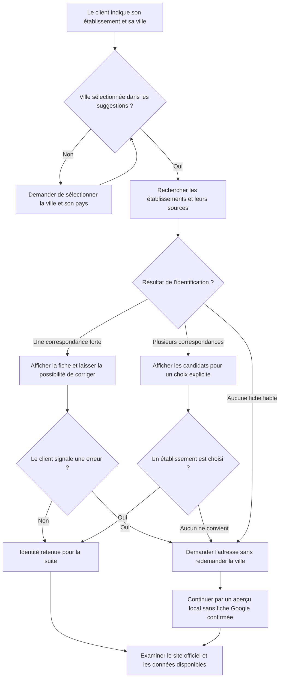
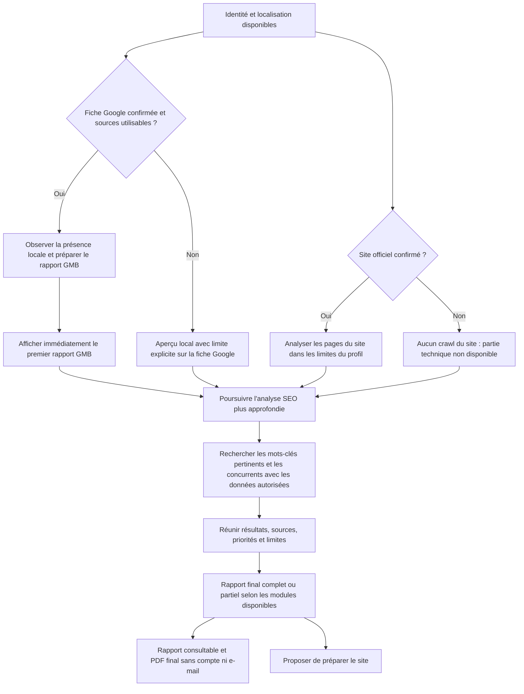
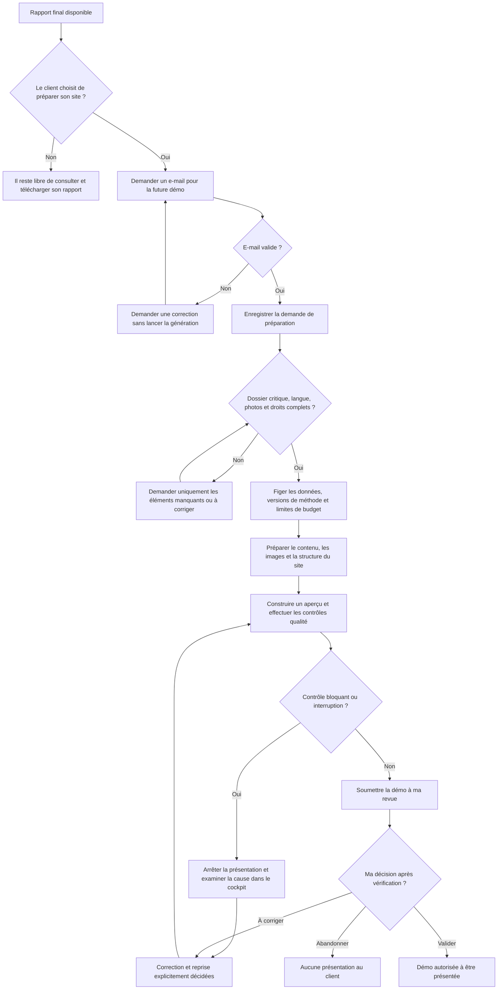

# Ancrage : les arbres de décision du parcours client

Mon travail ne se limite pas à créer un formulaire et un aperçu de site. J'ai conçu un parcours qui décide quoi rechercher, quoi demander au client, quels audits peuvent continuer et quand une démo peut être préparée puis présentée.

Cette page reprend les documents de conception déjà préparés en août 2026, notamment **89, Parcours client complet Website Factory** et **90, Correction du parcours rapport GMB + SEO**. Les diagrammes ci-dessous en proposent une lecture simplifiée pour comprendre les décisions métier sans lire le code.

**Comment lire cette page :** les diagrammes décrivent le parcours cible conçu. Une partie de ses règles existe dans le code du dépôt ; le formulaire photographié dans la visite ne raccorde pas encore toute cette chaîne. Les essais présentés sont des simulations locales, sans client réel ni appel payant. La dernière section indique précisément où retrouver la logique et ses limites.

GMB désigne la fiche d'établissement Google, aujourd'hui appelée Google Business Profile. Le SEO désigne le référencement naturel, c'est-à-dire la visibilité dans les moteurs de recherche.

## 1. Identifier le bon établissement

Le point de départ prévu est le nom de l'établissement et une ville sélectionnée dans des suggestions structurées. Le système doit éviter de travailler sur une entreprise qui porte le même nom mais se trouve ailleurs.

Une fiche non trouvée ou non confirmée ne prouve pas que l'entreprise n'en possède aucune. Les informations manquantes ou contradictoires doivent être signalées et complétées, plutôt que remplacées par une supposition.

## 2. Avec ou sans site : quels audits sont possibles ?

J'ai prévu une restitution progressive : le client voit le premier rapport GMB dès qu'il est disponible, pendant que l'analyse SEO plus large continue. Si le site officiel est confirmé, son analyse de base peut commencer en parallèle de l'observation de la fiche Google.

Le premier rapport GMB seul ne déclenche ni téléchargement PDF partiel ni préparation du site. Dans le parcours prévu, ces deux possibilités apparaissent au rapport final. L'analyse plus approfondie complète les premiers résultats ; elle ne garantit pas un meilleur classement dans Google.

| Situation du client | Ce qui peut continuer | Ce qui doit rester explicite |
| --- | --- | --- |
| Fiche Google et site confirmés | Observation locale, analyse du site, mots-clés et concurrence selon les sources disponibles | Périmètre, données observées et limites des résultats |
| Fiche Google confirmée, aucun site confirmé | Rapport GMB et recherche locale de mots-clés et de concurrence | Aucun audit technique d'un site inexistant ou non confirmé |
| Site confirmé, fiche Google non confirmée | Analyse du site et aperçu local | Aucune conclusion présentée comme un audit d'une fiche Google confirmée |
| Ni site ni fiche confirmés | Collecte ciblée et aperçu local si les données le permettent | Les modules non exécutés restent indiqués ; le dossier peut être complété pour une future démo |
| Service externe indisponible ou budget insuffisant | Conserver les résultats obtenus et expliquer les modules partiels ou bloqués | Aucun résultat inventé pour remplacer un appel non effectué |

### Ce que les analyses examinent

**Présence locale :** identifier l'établissement, recouper sa fiche et son adresse, conserver les sources et les éléments disponibles. Dans le code public actuel, le module GMB rassemble surtout des candidats et leur état de confirmation ; sa présence ne prouve pas encore un audit complet de tous les critères d'une fiche.

**Site existant :** parcourir un nombre limité de pages et vérifier notamment les titres, descriptions, langue, adaptation mobile déclarée, liens canoniques, titres principaux, textes alternatifs des images et données structurées. Les contrôles de code disponibles ne constituent pas un audit illimité ni une mesure réelle de tous les aspects de performance.

**Mots-clés et concurrence :** préparer des requêtes à partir de l'activité observée et de la ville, filtrer les résultats hors sujet, compléter les mesures disponibles et distinguer les concurrents locaux des candidats concurrents en référencement. Sans catégorie métier observée ou résultat exploitable, la limite doit être indiquée. L'IA prépare un plan de recherche ; ses propositions ne sont pas des volumes de recherche mesurés.

## 3. Du rapport à la préparation d'une démo

Le client garde la possibilité de lire son rapport sans demander de site. Dans le parcours conçu, son clic sur « Préparer mon site » ouvre la collecte d'un e-mail et la vérification du dossier. L'e-mail seul ne suffit pas à démarrer la génération.

Pour le premier segment, la restauration, le dossier prévu rassemble l'identité, l'adresse, un contact, le menu ou l'offre et les prix disponibles, la langue et cinq catégories de photos autorisées : façade, deux plats signatures, intérieur ou terrasse, équipe ou service. L'histoire du lieu peut enrichir le contenu. Les informations critiques contradictoires doivent être corrigées avant génération ; aucune offre, aucun prix ni horaire n'est inventé.

Le parcours commercial cible prévoit ensuite un lien privé de démo, puis une décision d'achat éventuelle et enfin les étapes de domaine et de publication. **L'envoi d'e-mail, le paiement et la publication en production ne sont pas validés par les essais montrés dans ce dépôt.** L'objectif est de faire découvrir la démo avant une décision d'achat, avec une validation humaine avant présentation.

## 4. Ce que cette conception représente dans mon travail

- Définir les branches pour un établissement trouvé, ambigu ou non confirmé, avec ou sans site.
- Organiser des tâches parallèles et une restitution progressive pour rendre le premier résultat disponible sans attendre toutes les analyses.
- Définir les informations nécessaires à chaque étape et les conditions qui autorisent la suite.
- Prévoir les résultats partiels, les erreurs, les limites de coût et la reprise d'un travail interrompu.
- Séparer les faits, les mesures, les propositions et les informations à confirmer.
- Garder une validation humaine entre la génération d'un aperçu et sa présentation au client.

## 5. Où retrouver ces règles dans le dépôt ?

Ces liens permettent de vérifier le travail technique derrière les diagrammes. Il n'est pas nécessaire de lire ces fichiers pour comprendre le parcours.

| Fichier | Rôle et limite actuelle |
| --- | --- |
| [Orchestration des audits publics](../src/audit/public-audit-workflow.mjs) | Recherche d'établissement, recherche de site, premier rapport GMB puis continuation SEO, mots-clés, concurrence et rapport final. Un domaine fourni ou transmis par Google Places est utilisé ; les sites candidats découverts ne sont pas automatiquement adoptés comme site officiel. |
| [Raccordement des services](../src/app.mjs) | Retour du rapport GMB et poursuite de l'analyse par une tâche de continuation. |
| [États et conditions du parcours public](../src/public/public-control-plane.mjs) | Décision d'identification, rapports, e-mail, dossier, cinq catégories de photos, droits, démarrage et validation de la démo. Une indisponibilité du service peut bloquer la recherche initiale et donc toute la chaîne. |
| [Analyse SEO des pages](../src/audit/seo-audit.mjs) et [parcours du site](../src/audit/site-crawler.mjs) | Contrôles déterministes et collecte bornée, avec preuves et résultats partiels. |
| [Préparation de la recherche SEO](../src/audit/seo-research-planner.mjs) et [tri des résultats](../src/audit/seo-qualification.mjs) | Plan de recherche, repli sans IA, filtrage de pertinence et qualification des concurrents. |
| [Workflow configurable de recherche SEO](../fixtures/defaults/workflows/local-seo-research.json), [consigne](../fixtures/defaults/prompts/local-seo-research-planner.md) et [format attendu](../fixtures/defaults/contracts/seo-research-plan.schema.json) | Méthode, consigne versionnable et structure de résultat exigée. Ces fichiers ne contiennent pas à eux seuls tout l'arbre métier. |
| [Simulation de création de site](../src/simulation/client-site-simulation.mjs) | Chaîne de six étapes utilisée pour les captures : validation, rapport local, rapport SEO, contenu, aperçu et qualité. Ses audits sont simulés. |
| [Formulaire présenté dans la visite](../app/intake.mjs) | Collecte et stockage local du dossier ; le bouton « Voir mon audit » ouvre le formulaire suivant sans lancer la chaîne connectée. |
| [Tests des audits progressifs](../test/audit/public-audit-workflow.test.mjs) et [tests du parcours public](../test/public/public-control-plane.test.mjs) | Vérification des branches avec des services synthétiques ; validation des API réelles encore nécessaire. |

Les documents d'origine décrivent une conception plus large que le prototype public. Cette page conserve leur logique métier tout en signalant les écarts avec le code et les captures du 11 octobre 2026. Elle ne présente pas le parcours cible comme un service commercial déjà exploité.

[Revenir à la présentation du projet](../README.md) · [Ouvrir la visite guidée](VISITE-GUIDEE.md)
