# Ancrage, du parcours client à mon cockpit

Visite du prototype local, capturée le 11 octobre 2026. Cette page se lit sans installer de programme. Chaque capture peut être ouverte pour l'agrandir.

Ancrage est mon projet d'activité principal : préparer des audits de visibilité et des sites pour des entreprises locales. Mon travail porte sur le parcours du client, l'organisation de la production, le contrôle des résultats et la maîtrise des coûts.

Les établissements affichés sont des dossiers fictifs de démonstration. Je n'ai pas encore contacté de clients potentiels. Les six étapes exécutées ci-dessous sont une simulation locale : elles montrent le fonctionnement du processus, pas un audit réalisé auprès d'un vrai client.

## Le parcours en un coup d'œil

Le client indique son établissement et sa ville, complète son dossier, puis l'enregistre. Je retrouve ce dossier dans mon cockpit, lance une exécution, examine ses étapes et ses résultats et prends une décision. La configuration me permet de préparer les méthodes et leurs limites avant les exécutions suivantes.

Deux mots présents dans les écrans : un **workflow** est une suite d'étapes de travail ; un **run** est une exécution de cette suite sur un dossier donné.

[Voir les arbres de décision du parcours](ARBRE-DE-DECISION.md) : établissement trouvé ou ambigu, site présent ou non confirmé, rapport GMB puis SEO, dossier incomplet et validation de la démo.

## 1. Le client arrive sur l'entrée publique

L'écran présente Ancrage et propose de commencer avec le nom de l'établissement et sa ville. Les liens « Comment ça marche » et « Ce que vous recevez » expliquent le parcours prévu.

« Publique » désigne ici l'interface destinée au client, par opposition au cockpit de l'opérateur. Cette démonstration tourne sur mon ordinateur, pas sur un service ouvert aux clients sur Internet. Les promesses de l'écran décrivent le service visé ; les limites du prototype sont expliquées dans cette visite.

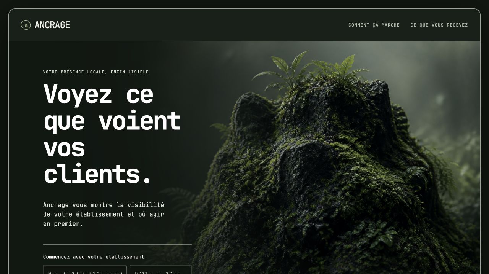

## 2. Le client indique le nom et la ville

Le nom et la ville servent de point de départ pour identifier le dossier. Ici, ils sont volontairement fictifs. Le bouton « Voir mon audit » ouvre actuellement la suite du formulaire ; il ne déclenche pas encore une recherche connectée ou un audit complet à partir de ces deux champs.

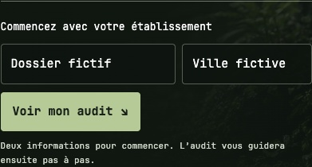

## 3. Il complète les informations de son établissement

Le formulaire rassemble le pays, l'adresse, l'histoire du lieu, le menu et ses prix, un e-mail de contact et une image. Cette version de l'entrée client est orientée vers les établissements de restauration. Il faudra adapter et tester les informations demandées pour d'autres types d'entreprises.

Le menu se saisit ligne par ligne avec le nom et le prix. Une image peut être jointe ; le formulaire limite son poids et accepte JPEG, PNG ou WebP. Pour ces captures, aucune image client ni coordonnée personnelle n'a été utilisée.

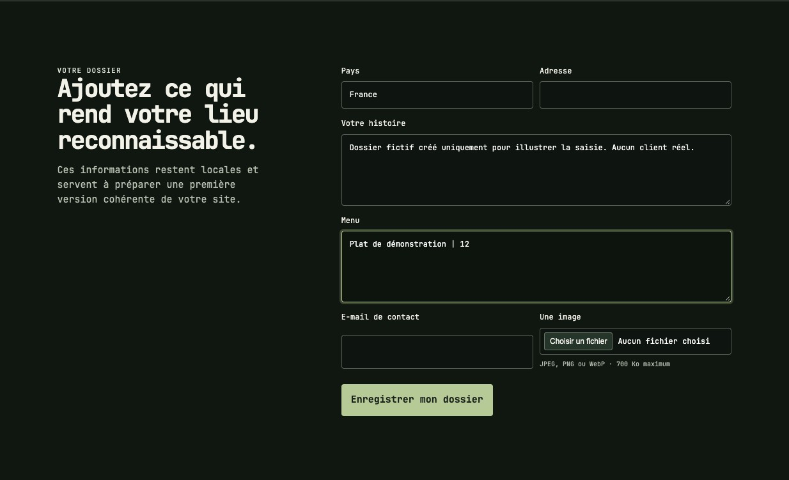

## 4. L'enregistrement confirme la réception

« Enregistrer mon dossier » conserve les informations localement. Le client obtient une confirmation ; le dossier devient consultable dans le cockpit. Cette confirmation n'est pas une commande, un paiement ou la livraison d'un audit.

Le lien vers le cockpit sert à visiter le prototype local. Il ne démontre pas encore une séparation sécurisée entre un compte client et un compte opérateur en production.

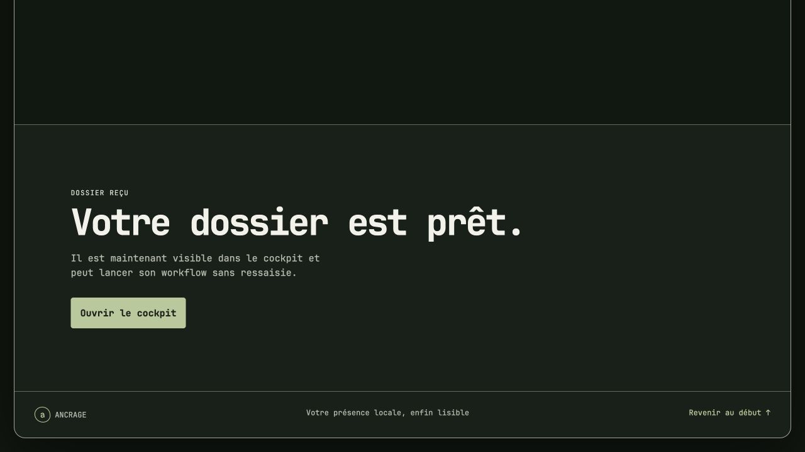

## 5. Mon cockpit : l'onglet À traiter

Je retrouve les dossiers qui demandent une action. La colonne centrale sert à choisir un dossier ; la partie droite indique l'action à faire et les éléments déjà contrôlés. Selon l'avancement, je peux préparer le site ou vérifier les résultats d'une exécution.

Les indicateurs signifient qu'un contrôle a réussi, qu'un point demande attention ou qu'une étape est terminée. Ils concernent les règles du prototype, pas une certification de qualité commerciale.

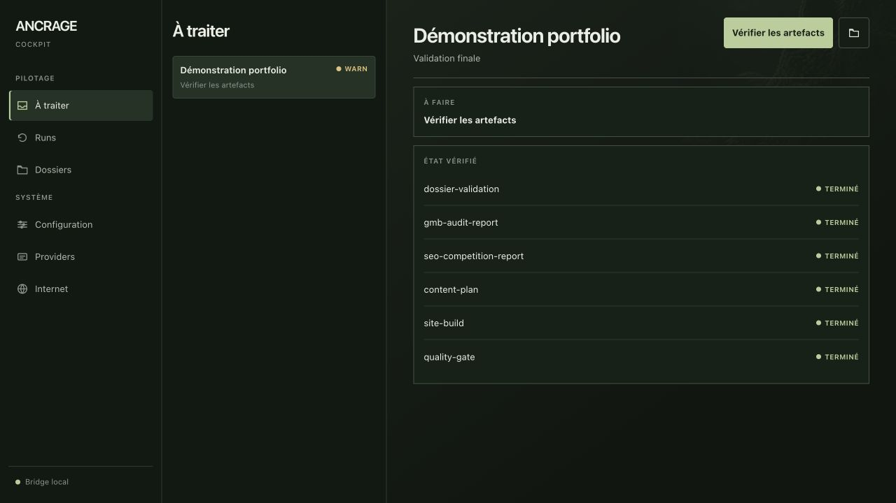

## 6. Runs, sous-onglet Vue : suivre une exécution

La liste regroupe les exécutions et permet de les rechercher. La vue générale indique le dossier, le workflow utilisé, l'état, le dernier point de reprise fiable, le nombre de tentatives et la décision encore à prendre.

Je peux examiner le travail avant de le valider ou de demander une correction. Si une exécution est bloquée ou échoue, le prototype prévoit une reprise depuis son dernier point fiable. Cet écran évite de confondre « le processus a terminé » et « j'ai accepté le résultat ».

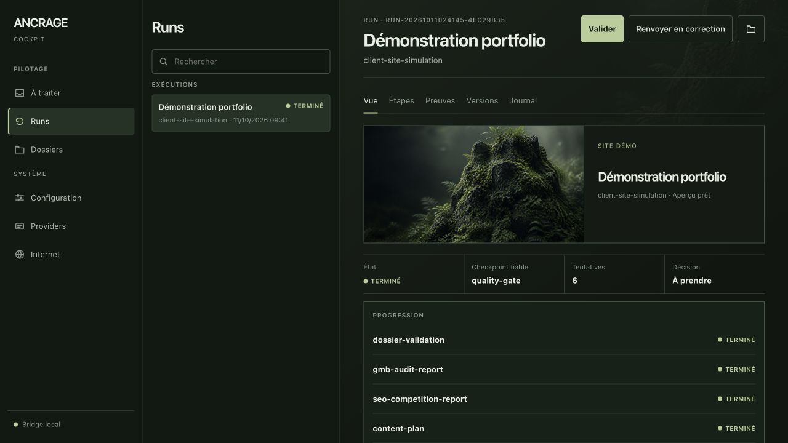

## 7. Runs, sous-onglet Étapes : voir le détail de la progression

Chaque ligne représente une tâche. Pour la simulation montrée ici :

| Nom dans l'écran | Rôle dans le parcours |
| --- | --- |
| dossier-validation | Contrôler les informations de départ |
| gmb-audit-report | Préparer le premier rapport de visibilité locale |
| seo-competition-report | Préparer le rapport de référencement et de concurrence |
| content-plan | Organiser les contenus du site |
| site-build | Produire un aperçu du site |
| quality-gate | Effectuer les contrôles de fin de parcours |

Les six lignes sont terminées pour ce dossier fictif. Les intitulés d'audit ne signifient pas que des recherches Google ou une comparaison de concurrents réels ont eu lieu dans cette simulation.

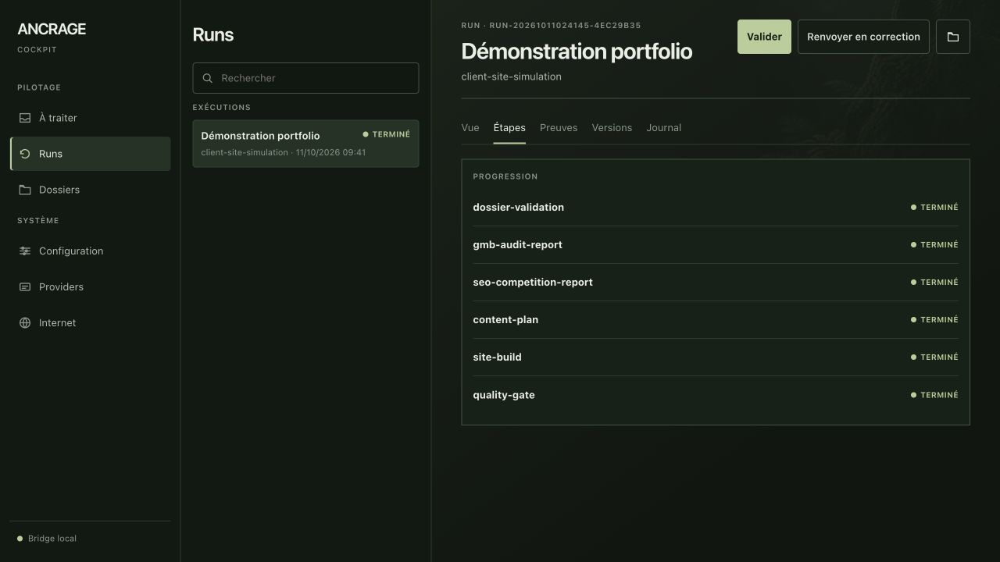

## 8. Runs, sous-onglet Preuves : retrouver les résultats

Cet écran donne accès à l'aperçu du site et aux rapports produits, avec le dossier qui leur a servi de source. Le mot technique « artefacts » désigne simplement ces fichiers et résultats conservés.

Je peux ouvrir et examiner les résultats au lieu de me fier uniquement à un voyant « terminé ». Les trois exemples suivants viennent réellement de l'exécution locale, mais leur contenu reste celui d'une simulation.

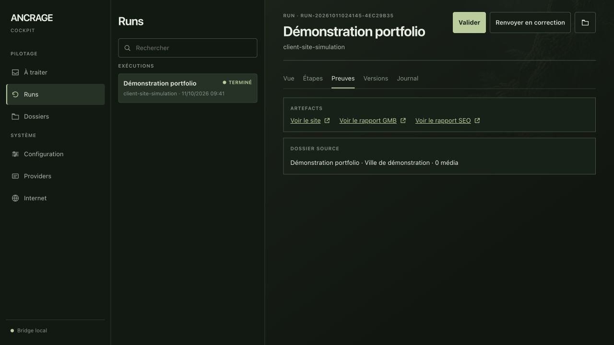

### Exemple : le premier rapport local

Le rapport récapitule les informations fournies et les points à confirmer. « GMB » désigne la fiche d'établissement Google, aujourd'hui appelée Google Business Profile. Dans cet exemple, aucune donnée réelle de fiche Google n'a été récupérée : le rapport l'indique dans son périmètre.

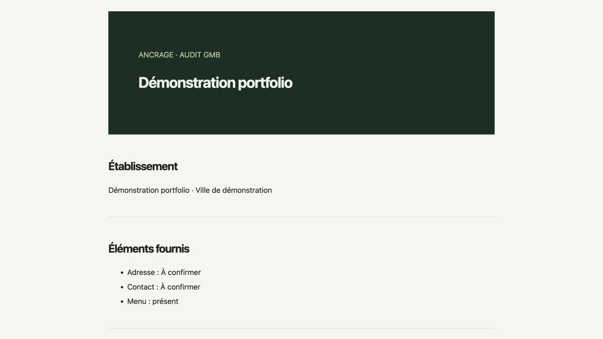

### Exemple : le rapport SEO et concurrence

Le référencement naturel, ou SEO, concerne la visibilité dans les moteurs de recherche. Ce rapport de simulation propose une structure de travail et des pistes à vérifier. Il ne mesure ni un classement Google, ni un volume de recherches, ni la position de concurrents réels.

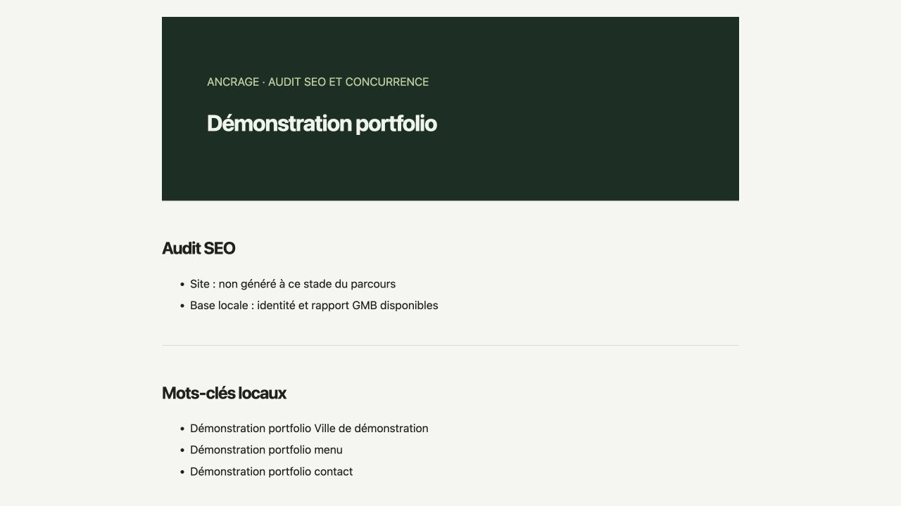

### Exemple : l'aperçu de site

L'aperçu reprend le nom, l'histoire et le menu du dossier. Il permet de voir comment les informations circulent jusqu'au résultat final. Ce modèle local n'est pas une preuve qu'un site commercial personnalisé a été généré par IA ou publié sur Internet.

## 9. Runs, sous-onglet Versions : savoir quels réglages ont été utilisés

Chaque exécution conserve les versions de sa méthode et de ses étapes. Je peux ainsi retrouver les réglages utilisés à ce moment-là, même si je modifie ensuite un workflow pour les travaux suivants.

Le long identifiant appelé « hash » est une empreinte du contenu : il sert à reconnaître une version précise. La conseillère n'a pas besoin de le déchiffrer ; ce qui compte est la traçabilité du travail.

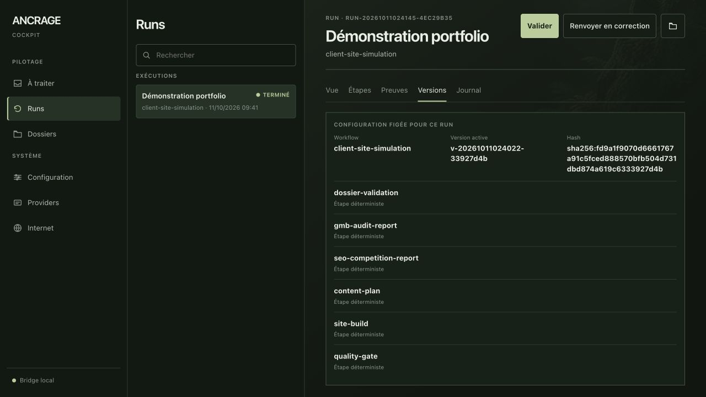

## 10. Runs, sous-onglet Journal : comprendre ce qui s'est passé

Le journal conserve les événements datés : démarrage, début et réussite de chaque étape, fin de l'exécution. Il aide à comprendre une interruption ou un échec et à retrouver l'ordre des opérations.

Ces dates sont celles de l'essai du 11 octobre, pas celles de la conception du projet.

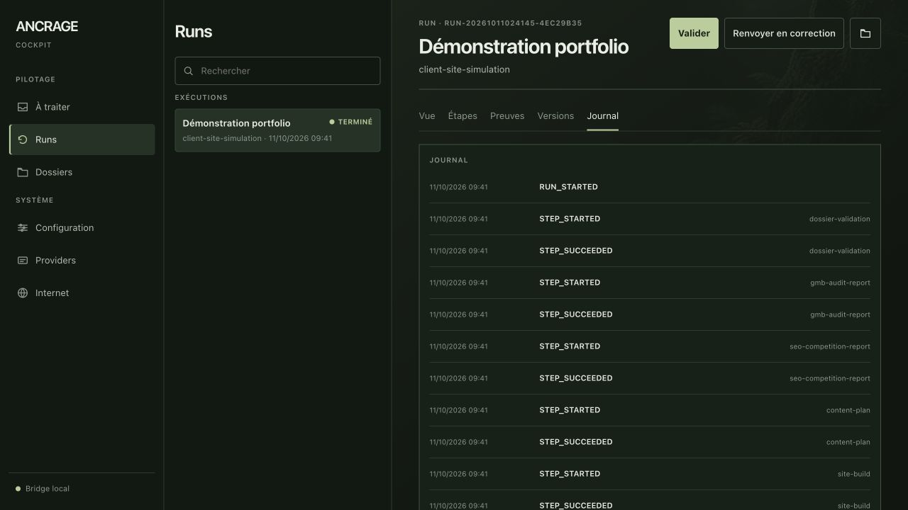

## 11. Dossiers, sous-onglet Identité

La liste permet de retrouver un établissement par son nom ou sa ville. La vue Identité rassemble sa ville, son pays, la provenance du dossier, son adresse et l'état de sa dernière exécution. Le bouton « Voir le run » relie le dossier au travail réalisé dessus.

Le bouton dossier permet aussi d'ouvrir les fichiers locaux dans Finder sur le Mac. Cette visite ne contient pas de dossier client réel.

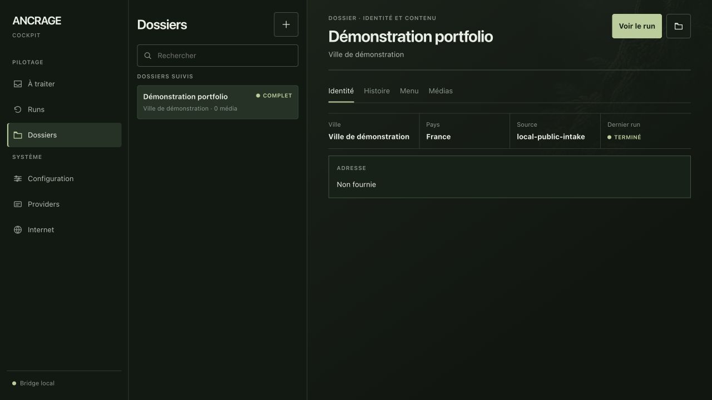

## 12. Dossiers, sous-onglet Histoire

Je retrouve le texte fourni par l'établissement : son histoire et ce qui le caractérise. Le conserver séparément aide à distinguer les informations du client des textes à préparer ensuite.

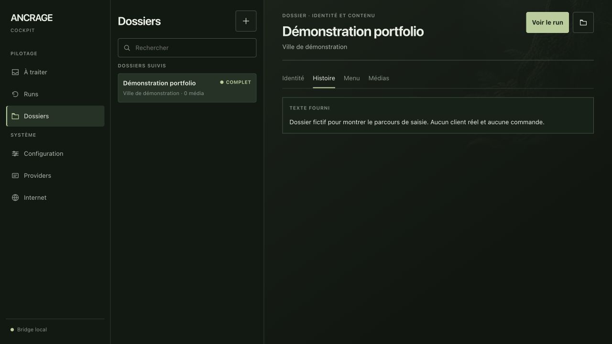

## 13. Dossiers, sous-onglet Menu

Je peux consulter les produits ou plats saisis et leurs prix. Dans ce prototype orienté restauration, le prix affiché appartient au menu de l'établissement : il n'est pas le prix de ma prestation ou le coût d'une API.

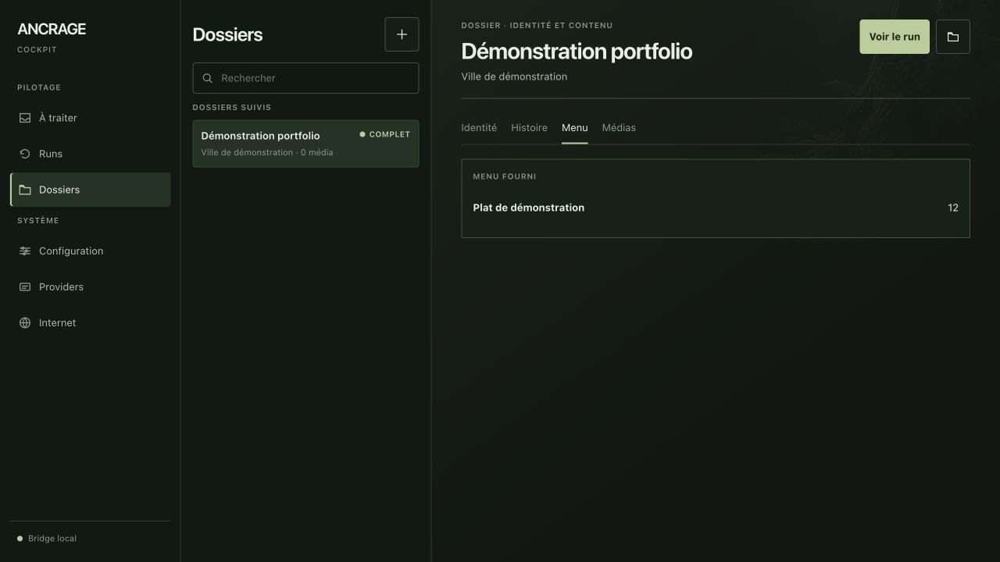

## 14. Dossiers, sous-onglet Médias

Cet onglet rassemble les images reçues avec le dossier. Je peux examiner ce qui a été fourni avant de préparer un site. L'exemple est volontairement vide : aucune photo n'a été ajoutée pour faire croire à un vrai client.

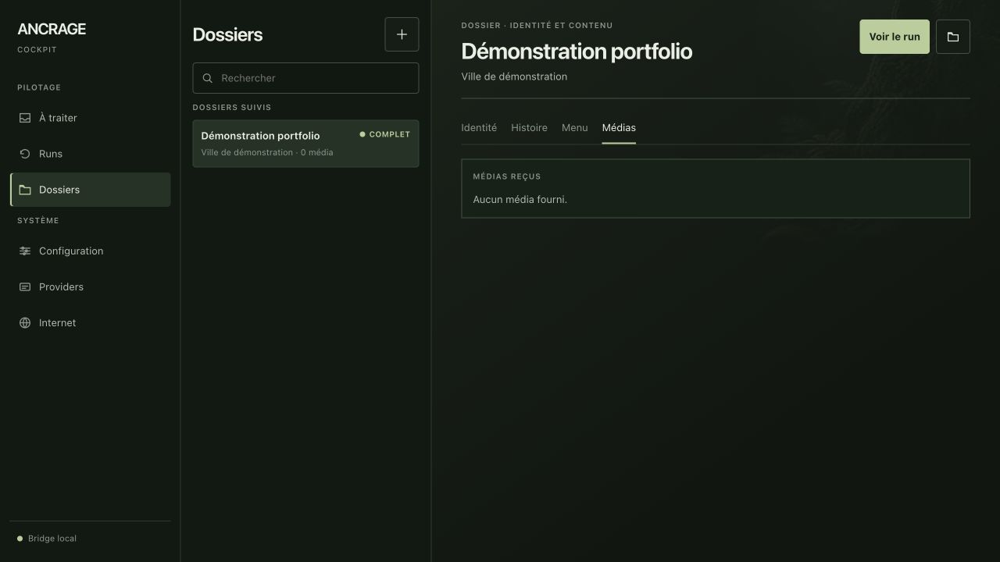

## 15. Configuration, sous-onglet Workflows

Je prépare ici la suite des tâches, leurs relations et les limites à respecter. Le cockpit ne sert donc pas uniquement à lancer une procédure fixe : il comprend un éditeur de méthodes de travail.

Le workflow « Création de site client » relie les six étapes montrées plus haut. Les champs URL, minutes, Mo et USD fixent des plafonds techniques de pages, de durée, de quantité de données et de budget. Ce sont des paramètres, pas des dépenses engagées ou des tarifs de vente.

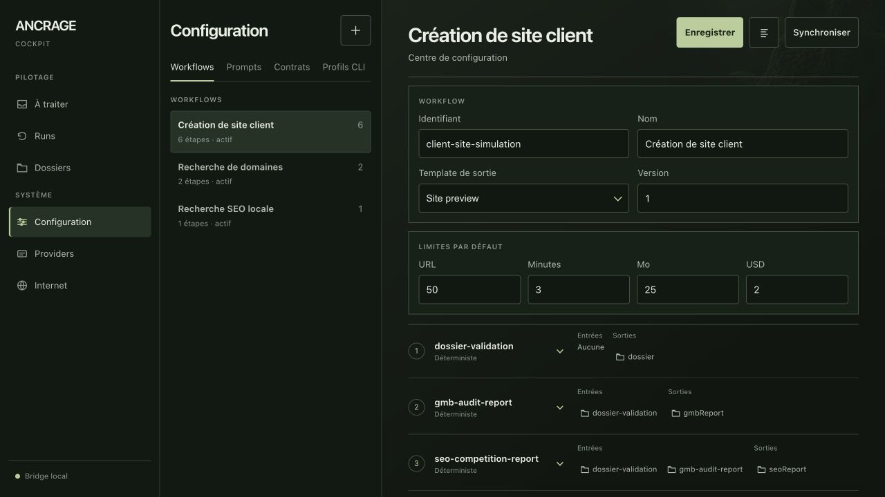

### Les autres workflows disponibles

« Recherche de domaines » organise une demande et des propositions de noms de domaine. Sa présence dans la liste ne prouve pas qu'une disponibilité a été vérifiée ou qu'un domaine a été acheté.

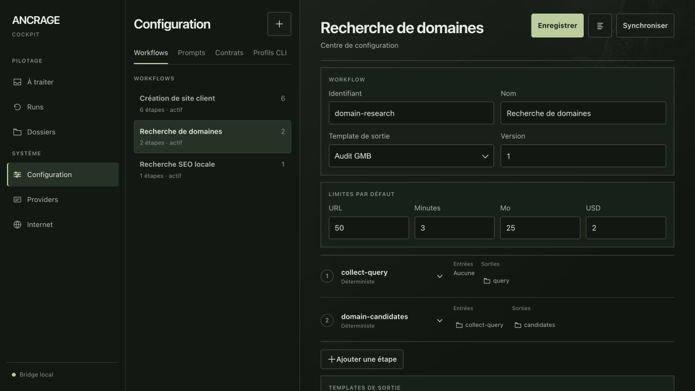

« Recherche SEO locale » prépare un plan de recherche avec une étape utilisant l'IA. Cette méthode doit être raccordée à un fournisseur autorisé et testée avec ses limites ; elle n'a pas été exécutée pour ces captures.

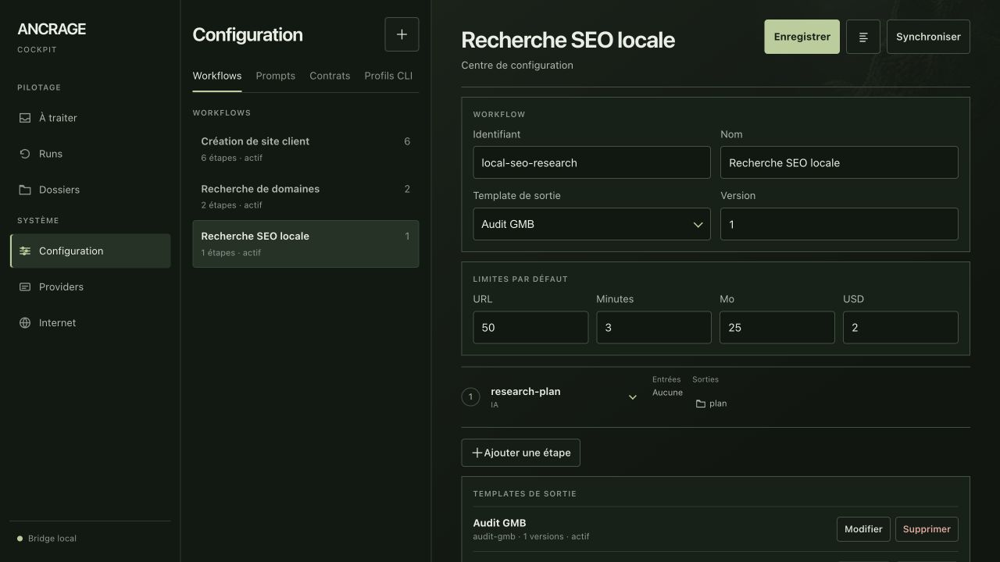

### Créer une nouvelle méthode

Le bouton « Créer un workflow » ouvre un formulaire : nom, identifiant, limites, étapes et modèle de résultat. « Ajouter une étape » permet d'étendre la chaîne. L'écran ci-dessous est un brouillon ouvert pour la visite, sans enregistrement d'une méthode supplémentaire.

Organiser des étapes et leurs dépendances n'est pas la même chose que programmer une exécution automatique à une date future : cette visite ne démontre pas de planificateur horaire.

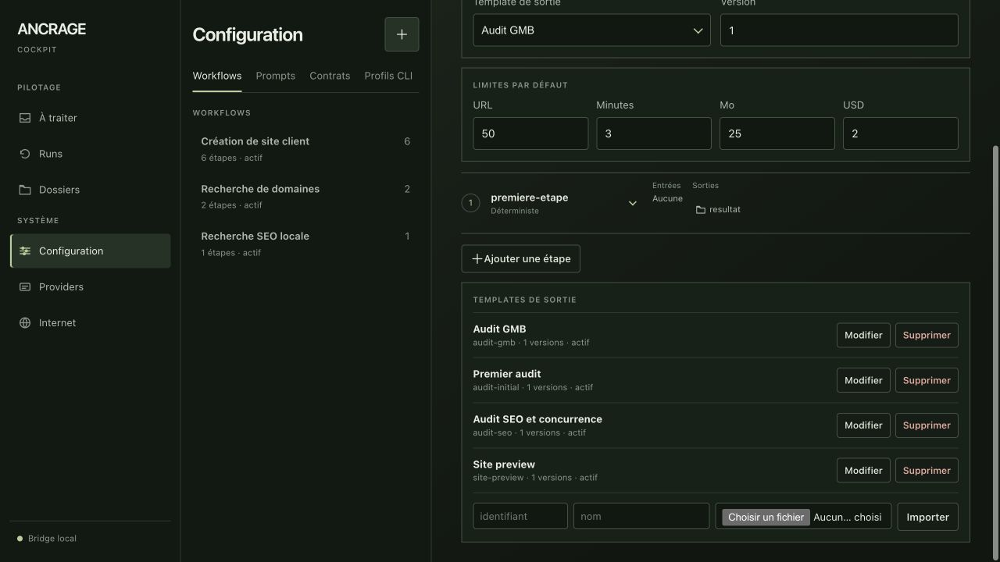

### Régler une étape et ses limites

Une étape précise le travail à effectuer, ce qu'elle attend des étapes précédentes et ce qu'elle doit produire. Je peux lui associer un format de sortie, un outil autorisé, un délai maximal et un budget.

Les dépendances évitent de lancer une tâche avant que ses informations soient prêtes. Les limites contribuent à éviter un traitement sans fin ou sans plafond de coût ; leur présence ne garantit pas à elle seule la rentabilité d'une prestation.

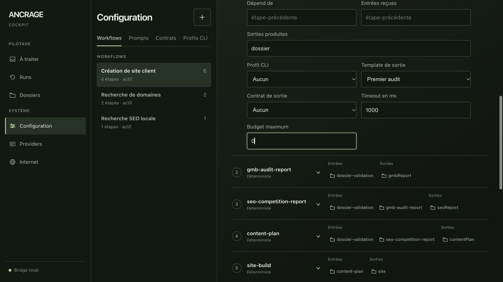

### Régler une étape utilisant l'IA

Pour une étape IA, les champs supplémentaires relient la consigne, le rôle, le fournisseur et le modèle choisi. Le contrat de sortie précise le résultat attendu. Un modèle indiqué dans le formulaire n'est pas la preuve d'une connexion saine : l'activation et les essais réels restent nécessaires.

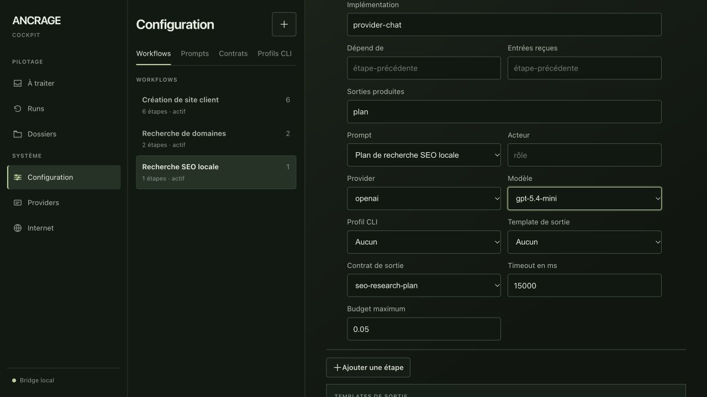

### Conserver les méthodes et les modèles de présentation

« Enregistrer » conserve le brouillon. « Créer une version » fige un état de la méthode ; l'activation détermine la version utilisée pour les futures exécutions. « Synchroniser » recharge les fichiers locaux dans l'éditeur. Les exécutions déjà faites gardent leurs propres références.

Les « templates » sont les modèles de présentation des rapports et de l'aperçu. Je peux les importer et les versionner. Cela permet de faire évoluer la forme d'un rapport sans confondre sa présentation avec les données qui l'alimentent.

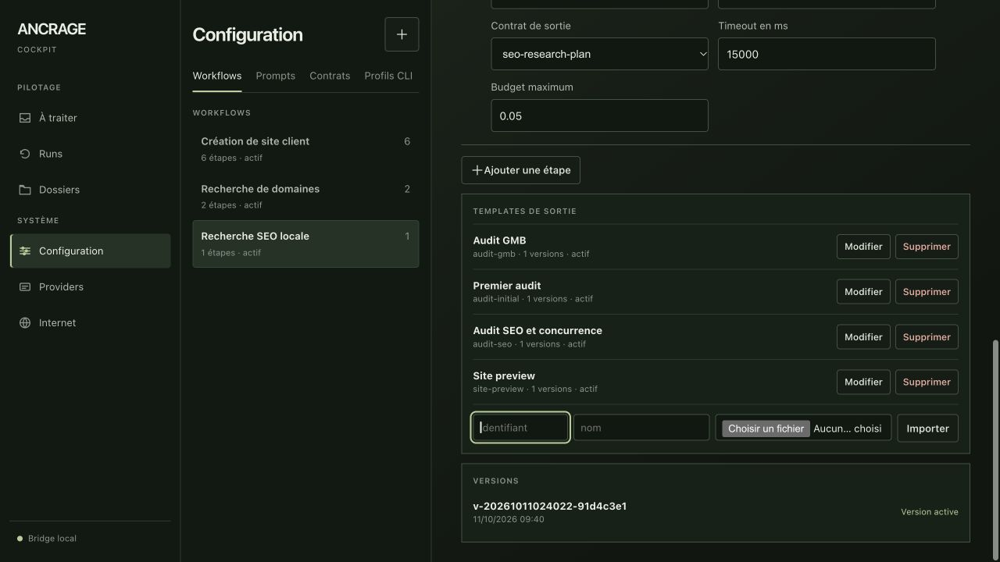

## 16. Configuration, sous-onglet Prompts

Un prompt est une consigne de travail. L'éditeur relie chaque consigne à une étape et au format du résultat attendu. Les consignes présentes couvrent l'analyse d'audit, la rédaction et la préparation d'une recherche SEO locale.

L'exemple demande de séparer les faits, les limites et les recommandations, sans inventer les données absentes. Je peux modifier ces consignes et conserver leurs versions. C'est une intention de contrôle ; il faut encore vérifier la qualité des réponses en conditions réelles.

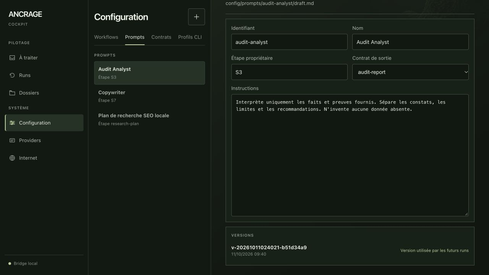

## 17. Configuration, sous-onglet Contrats

Il ne s'agit pas de contrats commerciaux. Un contrat de sortie définit la structure que doit respecter le résultat d'une étape. Pour un audit, l'exemple exige des constats, des limites et des recommandations.

Cela permet de refuser un résultat mal formé avant de poursuivre le processus. Un document peut respecter ce format tout en étant faux : le contrôle des sources et du contenu reste indispensable. Les formats présents concernent les audits, les textes, les propositions de domaines et les plans de recherche SEO.

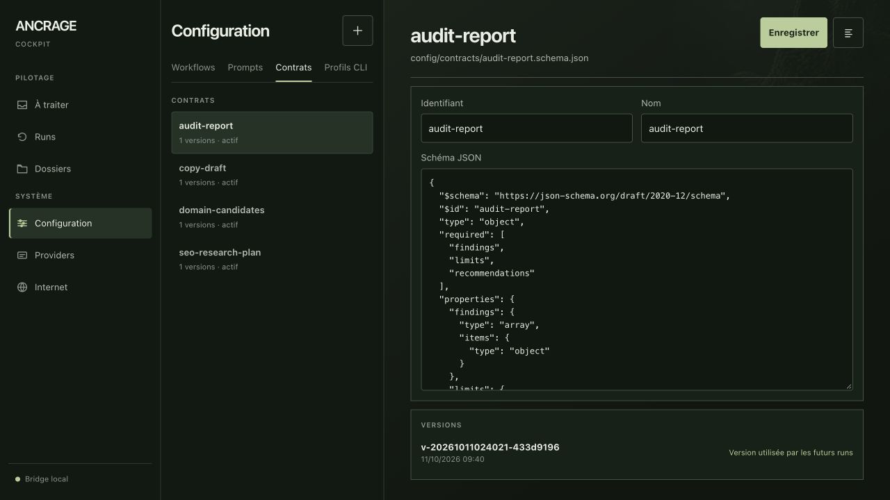

## 18. Configuration, sous-onglet Profils CLI

Cet onglet est destiné aux règles d'utilisation d'outils techniques lancés sur l'ordinateur : commande autorisée, paramètres, durée, taille maximale des résultats et destinations permises. L'objectif est de borner leur utilisation plutôt que d'autoriser n'importe quelle commande.

Aucun profil n'est configuré dans l'instance de démonstration. La capture montre cet état vide ; elle ne prouve pas une commande réelle exécutée ou validée depuis cet écran.

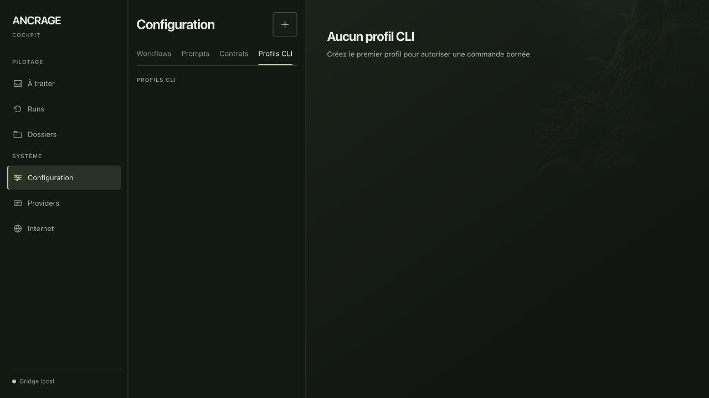

## 19. Providers : préparer les connexions aux services

« Providers » signifie fournisseurs de services externes. L'écran rassemble les moyens de connexion et les commandes d'activation. Les clés déjà présentes sont masquées ; aucune clé ou donnée de connexion n'est publiée dans cette visite.

| Services affichés | Rôle prévu dans Ancrage |
| --- | --- |
| OpenAI, Anthropic Claude, Google Gemini, OpenRouter | Services IA pour les étapes configurées |
| DataForSEO | Sources et traitements pour les recherches de référencement |
| Google Places | Informations d'identification d'établissements |
| Cloudflare, Dynadot, NameSilo, Name.com | Services liés aux noms de domaine |

Les boutons servent à enregistrer une connexion et à l'activer quand les conditions de validation sont remplies. Une clé masquée indique une clé enregistrée, pas un service testé et opérationnel. Pour cette visite, je n'ai ni changé de clé, ni activé de fournisseur, ni lancé d'appel payant.

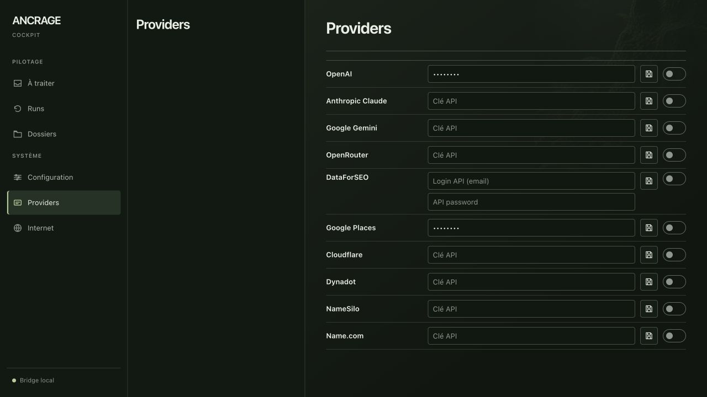

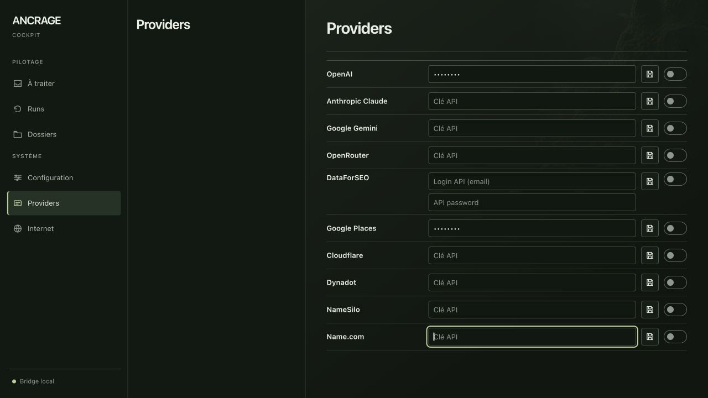

## 20. Internet : préparer une recherche de nom de domaine

Je peux saisir un nom de domaine à rechercher. Ce champ porte sur une adresse de site, pas sur une recherche générale sur le Web. Les résultats dépendent des services configurés.

Aucune recherche réelle, réservation ou acquisition de domaine n'a été effectuée pour ces captures.

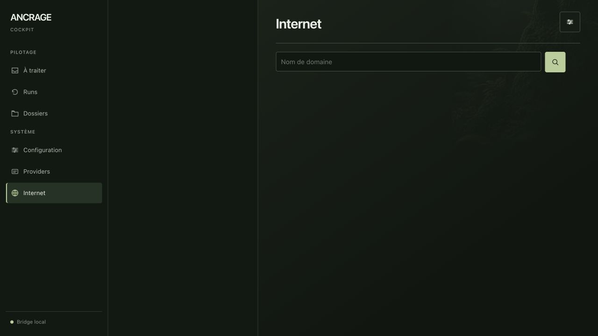

### Afficher les connexions Internet

Le panneau montre les services de domaines, leur état et leur activation. Ici, ils sont « Non testé » et « Inactif ». Cette visibilité est utile pour comprendre pourquoi une fonction n'est pas encore disponible et ce qu'il reste à configurer.

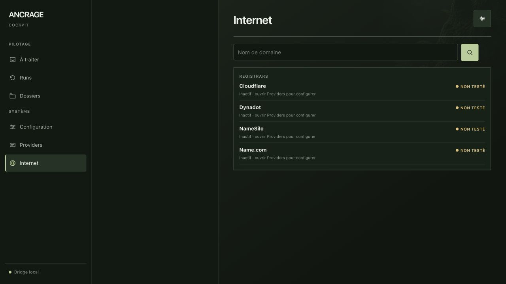

## Ce que cette visite montre de mon travail

J'ai travaillé sur la collecte des informations, leur conservation dans un dossier, l'organisation de tâches dépendantes, le suivi d'une exécution, l'accès aux résultats, la validation humaine, les versions et les limites techniques de coût. Ces éléments composent un outil de préparation d'activité, au-delà d'une simple page de présentation.

Le 11 octobre, la saisie et le stockage local, la simulation en six étapes et l'ouverture des rapports et de l'aperçu ont été observés. Les 116 tests locaux sont passés ; dix tests HTTP ciblés ont aussi vérifié les routes, la réception du dossier et les résultats de la simulation. Ces essais ne valident pas les fournisseurs réels ou un service commercial.

Je travaille maintenant sur le raccordement et la validation des API et des coûts. Il reste à vérifier les audits réels, l'accès client et opérateur en production, l'hébergement, la publication, la sauvegarde et restauration, puis à préciser l'offre et à la tester auprès de clients potentiels.

[Revenir à la présentation d'Ancrage](../README.md)
