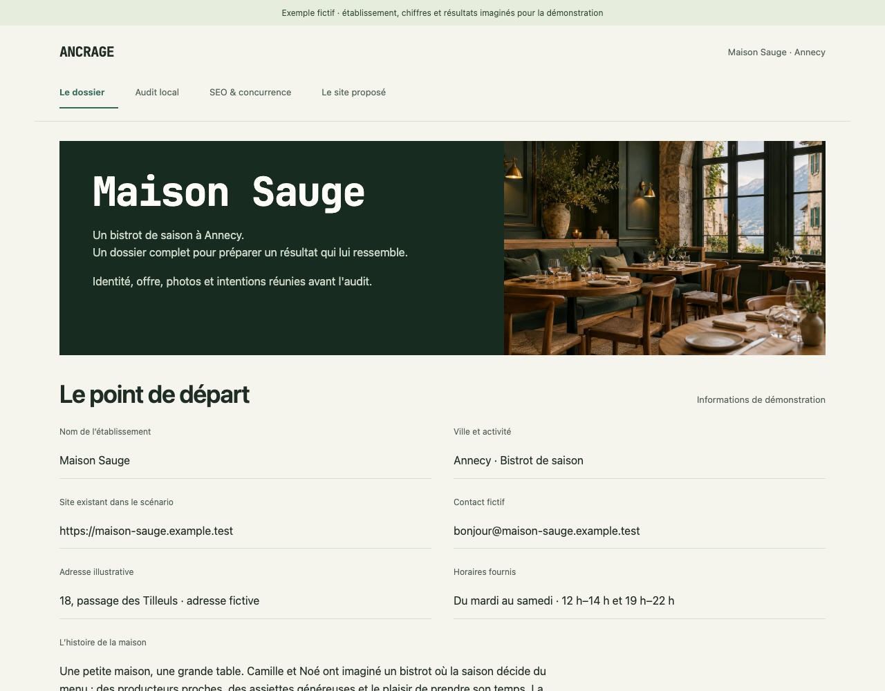
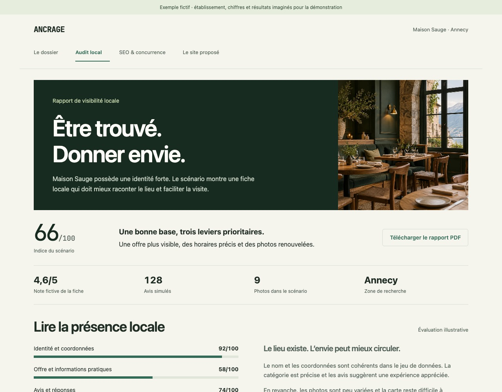
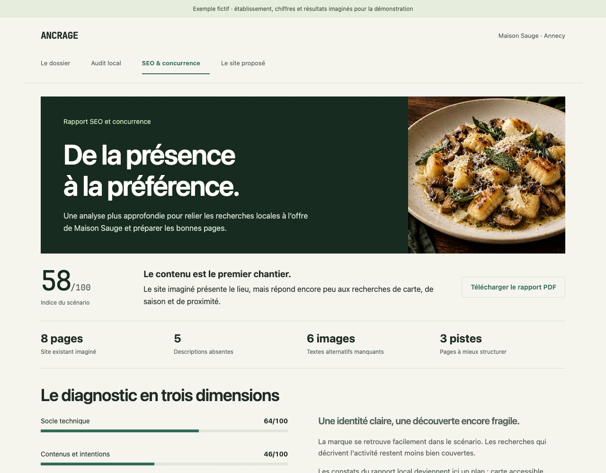
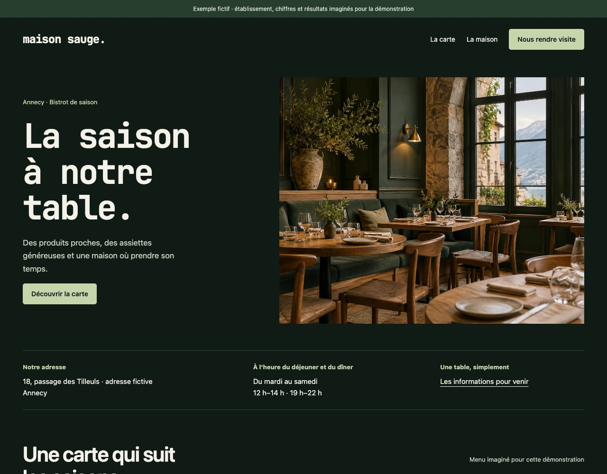

# Maison Sauge : un exemple complet d'Ancrage

Un dossier de restaurant, un premier diagnostic local, une analyse SEO plus approfondie et une démo de site dans les verts d'Ancrage. Cet exemple montre comment les informations d'entrée peuvent devenir des décisions puis un résultat visuel.

**Maison Sauge est un établissement fictif.** Les noms, coordonnées, prix, avis, indices, volumes de recherche, positions, constats et concurrents sont imaginés pour cette démonstration. Les photographies sont générées. Aucun audit de restaurant réel, recherche payante, réservation ou envoi n'a eu lieu.

## Le dossier d'entrée

Le même jeu de données alimente les quatre pages : bistrot de saison à Annecy, histoire du lieu, horaires, offre avec quatre plats et prix, site existant imaginé et photographies. Les rapports complètent le scénario avec des indicateurs simulés.

[Consulter les données du scénario](maison-sauge.json)

## Le premier rapport : la présence locale

Le rapport propose une synthèse, quatre dimensions de diagnostic, trois actions prioritaires et une lecture des informations pratiques. Son indice de 66/100 est la moyenne arrondie de quatre valeurs illustratives : 92, 58, 74 et 38.

[Ouvrir le rapport local complet en PDF](audit-local.pdf)

## Le second rapport : SEO et concurrence

Ce rapport complète le premier : état du site imaginé, intentions de recherche, mots-clés avec volumes et positions fictifs, trois profils de concurrents et étapes de travail. L'indice de 58/100 est la moyenne des trois valeurs illustratives : 64, 46 et 64.

[Ouvrir le rapport SEO complet en PDF](audit-seo.pdf)

## Le résultat : une démo de restaurant

La démo présente le lieu, sa carte, son histoire et les informations utiles à une visite. Les liens « La carte », « La maison » et « Nous rendre visite » ouvrent les bonnes sections. Le contact est illustratif ; aucune réservation n'est envoyée.

## Parcourir les quatre pages

[Télécharger le dépôt ZIP](https://github.com/cpointis96-hue/business-site-factory/archive/HEAD.zip), l'extraire, puis ouvrir **`docs/examples/dossier.html`** dans un navigateur. Aucun serveur ni installation n'est requis. La navigation relie le dossier aux rapports, puis au site. Les images, la police et les PDF sont inclus et consultables hors connexion.

GitHub présente les fichiers HTML comme du code ; les captures et les PDF ci-dessus permettent de découvrir le résultat directement sur GitHub.

| Fichier | Contenu |
| --- | --- |
| [dossier.html](dossier.html) | Informations d'entrée et photos du scénario |
| [audit-local.html](audit-local.html) | Rapport de visibilité locale |
| [audit-seo.html](audit-seo.html) | Rapport SEO et concurrence |
| [site-demo.html](site-demo.html) | Site de restaurant navigable |
| [maison-sauge.json](maison-sauge.json) | Données fictives de départ et valeurs illustratives |
| [build-examples.mjs](build-examples.mjs) | Génération déterministe des quatre pages, avec Node.js et sans dépendance |
| [DESIGN.md](DESIGN.md) | Palette, composition et règles de présentation des exemples |

Les audits connectés et les six étapes de la simulation du cockpit restent distincts de ces exemples de présentation. Aucun résultat fictif n'est injecté dans un audit réel.

[Revenir à la visite guidée](../VISITE-GUIDEE.md) · [Revenir au projet](../../README.md)
